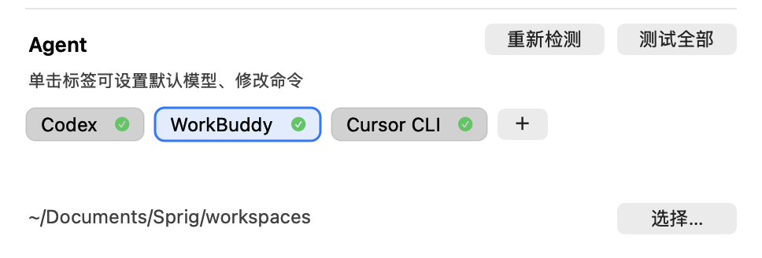

# Sprig · 知枝

[](https://github.com/thatwzzh/sprig/stargazers)
[](https://github.com/thatwzzh/sprig/releases)
[](https://github.com/thatwzzh/sprig/releases/latest)
[](LICENSE)
[](https://www.apple.com/macos/)

[简体中文](README.md) | **English**

**Hit `⌥Space`, ask a question, get an answer. Select any text in that answer and hit "Explain" — a child card grows in the knowledge tree on the right. Knowledge branches out like a sprig, which is where the name comes from.**

Not a chat client, not a note-taking app. It does one thing: **removes the friction between asking and asking deeper**.

### [⬇️ Download](https://github.com/thatwzzh/sprig/releases)

```
┌────────────────────────────────────────────┬──────────────────┐
│  Ask anything…             [gemini ⌄] [▤] │  Tree         12 │
├────────────────────────────────────────────┼──────────────────┤
│  RAG › Hallucination                       │  ▾ RAG           │
│  What is RAG and what problem does it solve?│   ▾ Hallucination│
├────────────────────────────────────────────┼────── ▸ Retrieval│
│  RAG (Retrieval-Augmented Generation)      │    ▸ Vector DB   │
│  combines retrieval with generation…       │                  │
│  It mitigates hallucination in LLMs.       │                  │
│  ┈┈ select any text → [Explain] ┈┈          │                  │
├────────────────────────────────────────────┤                  │
│  Ask a follow-up about this card…          │                  │
└────────────────────────────────────────────┴──────────────────┘
```

## What it is

A **question-answering panel** that lives in your menu bar. What sets it apart from a web-based AI chat is that **knowledge accumulates**:

- Ask a question, get a root card
- Select an unfamiliar term → `Explain`, and a child card grows
- Explain again, and it grows further — forming a knowledge tree you can walk back up

Every card remembers the context it was born in. Follow-ups carry only the relevant ancestors, not the entire conversation.

All data stays on your machine (`~/Library/Application Support/Sprig/repository/`). Model calls go directly to whichever provider you configure.

## Quick start

### 1. Install

**Requirements**: macOS 14 (Sonoma) or later. Apple Silicon and Intel both work.

1. Download the latest `.zip` from [Releases](https://github.com/thatwzzh/sprig/releases)
2. Unzip, drag `Sprig.app` into Applications
3. On first launch macOS says "cannot verify the developer" — go to **System Settings → Privacy & Security** and click **Open Anyway**

   > The app isn't code-signed (personal project), so this step is unavoidable. If that bothers you, build it yourself.

4. A sprout icon appears in your menu bar. Press `⌥Space` to summon the panel

### 2. Connect something that can answer

**Three paths — pick whichever fits:**

| If you… | Use | Cost |
|---|---|---|
| Already have Claude Code / Cursor / CodeBuddy installed | **Local agent** (recommended) | 0, reuses what you have |
| Want a cloud model | Free tier / your own API key | Free tiers are rate-limited |
| Prefer offline or have sensitive data | Local Ollama | 0, uses RAM |

**Settings → Agent** lists the agents already installed on your machine, each tag showing its handshake status:

| Icon | Meaning |
|---|---|
| ✓ | Handshake OK, ready to use |
| ! | Not logged in — run that agent once in a terminal to log in |
| ✕ | Failed, hover for the reason |
| ◌ | Testing |
| ○ | Not tested yet |

If you have no agents, add an API key under **Model providers** instead. Among the free options, Zhipu GLM-4.7-Flash is the steadiest (though roughly one in three requests still gets rate-limited).

### 3. Ask your first question

`⌥Space` → type → Enter. The answer streams in.

### 4. Make knowledge grow

Select an unfamiliar word in the answer → `Explain`. A child card appears, attached under the original.

## Core interactions

| Action | How |
|---|---|
| Summon / dismiss | `⌥Space` (configurable) |
| Ask (new root card) | Top input, Enter |
| Follow-up on current card | Bottom input, Enter (becomes a child card with context) |
| Explain selected text | Select → `Explain` |
| Expand a term inline | Terms are underlined; click one to spawn a child card |
| Go back to parent | Click the breadcrumb / `⌘[` |
| Switch model / agent / reasoning effort | Capsule on the right of the input, 🧠 icon |
| Toggle web search | Globe icon on the right; turns blue when on |
| Retry after an error | "↻ Retry this turn" at the end of the answer |
| Settings | `⌘,` or menu bar → Settings… |
| Dismiss | `Esc`: collapses tree → unfocuses input → hides panel |

**A few details worth knowing**:

- Terms in answers are auto-underlined; one click expands them
- If you switch cards mid-stream, that card **keeps generating in the background** — come back and the full answer is there
- Panel height only grows during streaming, so it never jitters as lines reflow
- Scrolling up while reading won't yank you back to the bottom — it only follows when you're already at the bottom

## Knowledge tree

Every card remembers the context it was born in. Follow-ups carry only the relevant ancestors.

| Action | How |
|---|---|
| Toggle tree | `⌘⇧T` (re-recordable in settings) |
| Search | `⌘F`, matches titles and answer bodies |
| Rename | Click an already-selected node, or press Enter; commit on blur, `Esc` cancels |
| Delete | Hover a node and click the trash icon, or `⌘⌫`; modal confirmation |

- Deletion cascades: removing a card takes all its children with it
- Search hits are highlighted on nodes; click to jump to that card

## Answer rendering

Replies are typeset as Markdown — no raw symbols dumped on screen:

- Headings, lists, blockquotes, and tables are rendered; tables wrap automatically
- Code blocks are syntax-highlighted (Swift / Python / JS / Go / SQL / nginx, etc.); inline code gets a background
- `mermaid` flowcharts and sequence diagrams are drawn inline; if rendering fails, the source is shown
- `sprig-chart` renders bar and line charts from JSON

## Reading themes

The answer pane ships with 10 themes; GitHub is the default. Also available: Newsprint (serif body), Solarized, One, Catppuccin, Dracula, Nord, Gruvbox, Rosé Pine, Tokyo Night.

Each has light and dark palettes that follow the system appearance. Themes change typography and color only — content is untouched, and existing cards re-render when you switch.

Settings → Reading theme.

## Connecting a local agent

**If you already have Claude Code, Cursor, CodeBuddy, or Gemini CLI installed, this is the least effort**: Sprig hands the question to the agent, the agent reads files and runs tools on its own, and Sprig just displays the result.

**Settings → Agent** auto-detects what's installed:

<p align="center">
  
</p>

- **Test all**: handshake with each one
- **Re-detect**: after installing or removing an agent, click this instead of reopening settings
- **＋**: add a custom agent (name + launch command)
- **Click a tag**: set a **default model**; custom entries can also rename and re-command. Click "Read" first to pull the model list; the first item is "follow the agent's default"
- **Working directory**: shared across all agents; this is the cwd they read and write files in

**Switching**: model capsule at the bottom of the panel → "Agent" group. While an agent is selected the web-search toggle is greyed out — whether to search is up to the agent.

**While waiting**, the agent's reasoning fragments and tool calls (e.g. `Bash: ls`) appear in the status line, yielding to the answer once the first token arrives.

**If not logged in**: the panel shows a login link; open it in your browser, and the agent retries automatically afterwards.

**Permissions**: when the agent needs to run a command it asks for approval (the title reads like `Bash: ls`). Choosing "Always Allow" sticks.

## Connecting a cloud model

| Category | Description |
|---|---|
| **Local Ollama** | Runs on your machine, completely free |
| **Free** | Zhipu GLM / OpenRouter / Gemini — drop in a key |
| **Custom** | Any OpenAI-compatible service (DeepSeek, OpenAI, Volcengine…) |

### Local (Ollama)

Just an address and a model name. The address defaults to `http://127.0.0.1:11434`; click "Sync models" to list what you've pulled.

> **Note**: pulling many models doesn't load them all into RAM. A model loads on first use and unloads after 10 minutes idle. What actually occupies disk is the weights (roughly 10 GB for a 9B model).

### Free tiers

| Provider | Get a key | Models |
|---|---|---|
| Zhipu GLM | [bigmodel.cn/usercenter/proj-mgmt/apikeys](https://bigmodel.cn/usercenter/proj-mgmt/apikeys) | `glm-4.7-flash` |
| OpenRouter | [openrouter.ai/keys](https://openrouter.ai/keys) | Those priced at zero that can chat |
| Gemini | [aistudio.google.com/apikey](https://aistudio.google.com/apikey) | `flash` family only; needs a proxy in mainland China |

**Zhipu requires identity verification** — keys from unverified accounts don't work.

**⚠️ On the stability of free tiers**:

| Provider | Real-world experience |
|---|---|
| Zhipu GLM-4.7-Flash | ~1 in 3 requests succeed; the rest return "model is busy" |
| Gemini free tier | Frequent 429s, plus a proxy is required in China |
| OpenRouter free | Heavy 429s at peak hours |

**These are good for trying the app out**, not for daily driving. For reliability use DeepSeek (custom provider, pay per token — 10 CNY lasts months) or local Ollama.

### Custom

Name, base URL, key, model name. Add as many as you like:

| Platform | Base URL | Example model |
|---|---|---|
| **DeepSeek** | `https://api.deepseek.com` | `deepseek-chat` (fast) / `deepseek-reasoner` |
| OpenAI | `https://api.openai.com/v1` | `gpt-4o-mini` |
| Volcengine (Doubao) | `https://ark.cn-beijing.volces.com/api/v3` | The endpoint ID from the console |
| Alibaba DashScope | `https://dashscope.aliyuncs.com/compatible-mode/v1` | `qwen-flash` |
| Groq | `https://api.groq.com/openai/v1` | `openai/gpt-oss-120b` |
| LM Studio | `http://127.0.0.1:1234/v1` | The loaded model name |

Base URLs with or without `/v1` both work; `https://x/v1` won't become `/v1/v1`.

### Proxy

**Settings → Web search → Proxy**, below the search toggle. Enter something like `http://127.0.0.1:7890` and every outbound request goes through it. Leave blank to follow system settings.

When you need it: for overseas services like Gemini, OpenAI, OpenRouter. Domestic ones (DeepSeek, Zhipu) don't need it.

## Web search

Knowledge questions often need current information, so Sprig wires up tool calling — **the model decides whether to search and what to search for**, rather than stuffing results into every prompt.

> With an agent selected this toggle is disabled — searching is up to the agent.

Setup: Settings → Web search → enable → pick a backend → add the key.

| Backend | Quota | Notes |
|---|---|---|
| **Tavily** | 1,000 calls/month free | International search, good quality, needs a proxy |
| **DeepSeek** | 5 CNY per 1,000 successful requests | Direct in China, better Chinese results |

Search results collapse into a single line:

```
🔍 Searched "gold price today", 3 sources      ← click to open the source menu
```

Clicking shows "title · domain"; hover for the summary, click to open the original.

**When it searches**: only for current events, live prices, or latest version numbers. For stable knowledge like "what is a design pattern", the model answers from its own knowledge — searching would only surface marketing posts.

## Markdown sync

**One knowledge tree = one Markdown file**, with child cards nested by level:

```markdown
<!-- sprig:root 7D51CB74-... -->

# RAG

What is RAG?

RAG (Retrieval-Augmented Generation) combines retrieval with generation.

## Hallucination

> Selected: hallucination

Here it means the model fabricates plausible-sounding but false facts.

Generated by Sprig. To edit, use the app; changes made directly to this file won't sync back.
```

- The file lives in your knowledge base directory (default `~/Library/Application Support/Sprig/repository/`), alongside `.cards.json`
- **Markdown is a projection, not the source**: edits in the app regenerate it; direct file edits get overwritten on the next save
- The `<!-- sprig:root ... -->` marker on the first line identifies generated files. Deleting a root card only removes files bearing that marker — notes you drop in yourself are left alone
- Switching the knowledge base directory copies the current one over if the target has none

## Configuration and backup

| Setting | Where | Default |
|---|---|---|
| Model providers | Menu bar → Settings… → Model providers | Zhipu free + Ollama |
| Agent | Menu bar → Settings… → Agent | Auto-detected |
| Agent working directory | Settings → Agent → Working directory | `~/Documents/Sprig/workspaces` |
| Knowledge base | Menu bar → Settings… → Knowledge base | `~/Library/Application Support/Sprig/repository` |
| Reading theme | Menu bar → Settings… → Reading theme | GitHub |
| Proxy | Menu bar → Settings… → Web search → Proxy | Empty (follow system) |

**API keys live in local preferences** (`~/Library/Preferences/com.catking.sprig.app.plist`) **in plain text** — don't sync this configuration to any cloud.

```bash
defaults export com.catking.sprig.app ~/sprig-backup.plist
defaults import com.catking.sprig.app ~/sprig-backup.plist
```

## FAQ

### "Cannot verify the developer"

Dismiss the dialog, then go to System Settings → Privacy & Security, scroll to the bottom, and click "Open Anyway", then authenticate.

### The menu bar icon disappeared

System Settings → **Menu Bar** → scroll to "Allow in the menu bar" and make sure Sprig is on.

### Constant 429s

Your free quota is exhausted. Wait a minute, or switch to a paid provider.

### TLS handshake failed

Usually the network can't reach the target domain: configure a proxy for OpenAI / Tavily, or switch the search backend to DeepSeek.

### I want the knowledge base in Documents

You can, but **it will prompt for permission on first use and again after each app version change** (macOS tracks authorization per app identity). Settings marks such paths in orange as "protected by the system".

To authorize once and never again across rebuilds, use a stable signing identity (`SPRIG_SIGN_IDENTITY`). See ARCHITECTURE for details.

## For developers

Technical details live in [ARCHITECTURE.md](ARCHITECTURE.md): layering, data flow, context assembly, ACP integration, rendering pipeline, headless verification.

### Build from source

```bash
git clone https://github.com/thatwzzh/sprig.git
cd sprig
./scripts/make-app.sh          # produces build/Sprig.app
open build/Sprig.app

swift test --disable-sandbox   # unit tests
./scripts/restart-app.sh       # quit old instance → build → launch → verify single instance
```

### Releasing

Version numbers have a single source: **the git tag**. The build script reads it from there.

```bash
git tag v0.2.1 && git push origin v0.2.1
./scripts/release.sh            # check → build → verify → build/Sprig-v0.2.1.zip
gh release create v0.2.1 build/Sprig-v0.2.1.zip --title "Sprig v0.2.1"
```

The script blocks four situations that would produce a wrong version: uncommitted changes, not on main, HEAD not on the tag, or a mismatch between the bundled version and the tag.

### Debugging

```bash
Sprig --selftest                  # headless check of layout/selection/copy
Sprig --settings --dump           # dump settings form state
Sprig --headless "question"       # run provider + parser only
Sprig --test-agents               # handshake with every configured agent
Sprig --acp-host-info             # show bundled acp-host path and version
Sprig --readme-shots /tmp/shots   # generate README screenshots from a temp library
SPRIG_ACP_TRACE=/tmp/acp.log Sprig --ask "hello"   # log raw ACP frames
```

The full list is in ARCHITECTURE's "Testing and debugging" section.

---

**License**: MIT · **Feedback**: [Issues](https://github.com/thatwzzh/sprig/issues)
