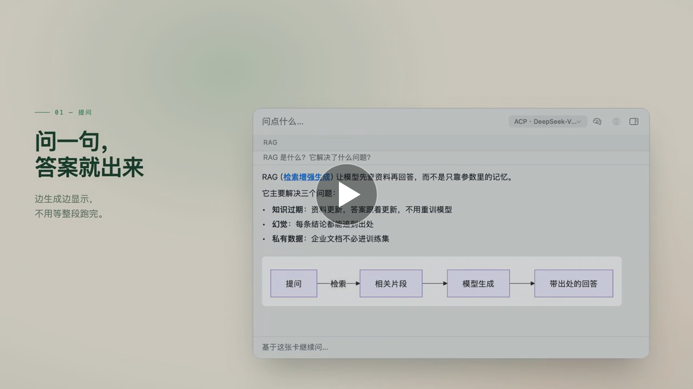
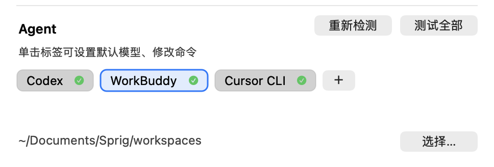

# Sprig · 知枝

[中文](README.md) · [English](README.en.md)

[](https://github.com/thatwzzh/sprig/stargazers)
[](https://github.com/thatwzzh/sprig/releases)
[](https://github.com/thatwzzh/sprig/releases/latest)
[](LICENSE)
[](https://www.apple.com/macos/)

**Hit `⌥Space`, ask a question, get an answer. Select any text in that answer and hit "Explain" — a child card grows in the knowledge tree on the right. Knowledge branches out like a sprig, which is where the name comes from.**

Not a chat client, not a note-taking app. It does one thing: **removes the friction between asking and asking deeper**.

### Download　[🇨🇳 China mirror](https://sprig-site.app.workbuddy.host/downloads/Sprig-latest.zip?sharecode=HVF3SOVDGG)　·　[🌍 GitHub Releases](https://github.com/thatwzzh/sprig/releases)

> The China mirror is faster from mainland China; GitHub is better overseas or for older versions. You can also watch the demo on the [website](https://sprig-site.app.workbuddy.host/?sharecode=HVF3SOVDGG).

<p align="center">
  <a href="https://sprig-site.app.workbuddy.host/?sharecode=HVF3SOVDGG" target="_blank" rel="noopener">
    
  </a>
</p>

## What it is

A **question-answering panel** that lives in your menu bar. What sets it apart from a web-based AI chat is that **knowledge accumulates**:

- Ask a question, get a root card
- Select an unfamiliar term → `Explain`, and a child card grows
- Explain again, and it grows further — forming a knowledge tree you can walk back up

Every card remembers the context it was born in. Follow-ups carry only the relevant ancestors, not the entire conversation.

All data stays on your machine (`~/Library/Application Support/Sprig/repository/`). Model calls go directly to whichever provider you configure.

## Quick start

### 1. Install

**Requirements**: macOS 14 (Sonoma) or later. Apple Silicon and Intel both work.

1. Download the latest `.zip` from [Releases](https://github.com/thatwzzh/sprig/releases)
2. Unzip, drag `Sprig.app` into Applications
3. On first launch macOS says "cannot verify the developer" — go to **System Settings → Privacy & Security** and click **Open Anyway**

   > The app isn't code-signed (personal project), so this step is unavoidable. If that bothers you, build it yourself.

4. A sprout icon appears in your menu bar. Press `⌥Space` to summon the panel

### 2. Connect something that can answer

**Three paths — pick whichever fits:**

| If you… | Use | Cost |
|---|---|---|
| Already have Claude Code / Cursor / CodeBuddy installed | **Local agent** (recommended) | 0, reuses what you have |
| Want a cloud model | Free tier / your own API key | Free tiers are rate-limited |
| Prefer offline or have sensitive data | Local Ollama | 0, uses RAM |

**Settings → Agent** lists the agents already installed on your machine, each tag showing its handshake status:

| Icon | Meaning |
|---|---|
| ✓ | Handshake OK, ready to use |
| ! | Not logged in — run that agent once in a terminal to log in |
| ✕ | Failed, hover for the reason |
| ◌ | Testing |
| ○ | Not tested yet |

If you have no agents, add an API key under **Model providers** instead. Among the free options, Zhipu GLM-4.7-Flash is the steadiest (though roughly one in three requests still gets rate-limited).

### 3. Ask your first question

`⌥Space` → type → Enter. The answer streams in.

### 4. Make knowledge grow

Select an unfamiliar word in the answer → `Explain`. A child card appears, attached under the original.

## Core interactions

| Action | How |
|---|---|
| Summon / dismiss | `⌥Space` (configurable) |
| Ask (new root card) | Top input, Enter |
| Follow-up on current card | Bottom input, Enter (becomes a child card with context) |
| Explain selected text | Select → `Explain` |
| Expand a term inline | Terms are underlined; click one to spawn a child card |
| Go back to parent | Click the breadcrumb / `⌘[` |
| Switch model / agent / reasoning effort | Capsule on the right of the input, 🧠 icon |
| Toggle web search | Globe icon on the right; turns blue when on |
| Retry after an error | "↻ Retry this turn" at the end of the answer |
| Settings | `⌘,` or menu bar → Settings… |
| Dismiss | `Esc`: collapses tree → unfocuses input → hides panel |

**A few details worth knowing**:

- Terms in answers are auto-underlined; one click expands them
- If you switch cards mid-stream, that card **keeps generating in the background** — come back and the full answer is there
- Panel height only grows during streaming, so it never jitters as lines reflow
- Scrolling up while reading won't yank you back to the bottom — it only follows when you're already at the bottom

## Cross-app selection

Besides selecting text inside the panel, Sprig can turn text selected in **other apps** into an explanation card that carries its source:

| Entry | How | Permission |
|---|---|---|
| Hotkey | select text → `⌥⇧Space` (remappable) | Accessibility (reads the current selection once) |
| Menu bar | "Explain current selection" / "Explain clipboard" | Accessibility for the selection; clipboard needs none |
| Services | select text → right-click → Services → "Explain with Sprig" | none |
| URL scheme | `open "sprig://explain?text=…&url=…&title=…"` | none |

The explanation carries as much source context as it can find: **web pages** fetch the public body and locate the paragraph containing the selection; **local Markdown / Obsidian / PDF / Office files** are resolved by window title or file path and bring heading level, page number, and surrounding paragraph; **DSH conversations** go through a dedicated plugin that pulls the real messages; **other apps** fall back to whatever AX text is nearby. The source shows above the question bar — click it to jump back to the original.

Long documents are not just "selection ± N characters". Markdown splits by heading, PPTX by slide, web pages by paragraph; Sprig takes the section containing the selection, then uses keywords (Chinese bigrams + English words) to pull the 1–2 most relevant passages from other sections. PDFs open a window centred on the selection spanning pages, naturally including the tail of the previous page when the selection sits at the top. **Everything is computed locally by default — no LLM summarisation** — with a context ceiling around 1200 characters. The ⓘ next to the source line previews exactly what gets sent to the model and the token estimate.

Settings can enable **deep context** (long-document / long-conversation summarisation): only when the context clearly exceeds the budget (~1200 tokens) does Sprig ask the active model to condense the surrounding material (the selection itself stays verbatim). Summaries are cached by content, so the same material is never sent twice; with no model configured it falls back to local extraction and the explanation still works.

Boundaries and privacy:

- No background listening — the selection is read once, when you press the hotkey, click the menu item, or invoke the service.
- Accessibility permission is required on first use. **An ad-hoc build asks again after every reinstall** — that is macOS tracking authorisation by signature, not something Sprig can bypass.
- Web fetching only requests public `http(s)` URLs and refuses private/loopback addresses. It can be turned off in settings.
- Document lookup requires adding document folders or Obsidian vaults manually. **`~/Documents` is never scanned automatically.**
- PDFs must have a text layer; scanned PDFs yield only the selection. Office files contribute body text only (docx paragraphs / pptx slides / xlsx rows) — no images, charts, or layout.
- For DSH conversations use the dedicated plugin. For other Electron apps, when AX exposes no conversation context, Sprig simulates one ⌘C and restores the clipboard — that guarantees the selection but not the surrounding messages.
- ACP agent mode is a **Q&A mode**: the agent will not be asked to call Grep/Bash/Read, and tool permissions are denied automatically. If you need the agent to actually do work, use its own client.

### Cross-app selection settings

Menu bar → Settings… → two tabs at the top, **General / Cross-app selection**:

- **General**: model providers, agents, knowledge base, web search, deep context;
- **Cross-app selection**: master switch, explain-selection hotkey, accessibility status and a shortcut to grant it, selection length ceiling (default 500 chars, configurable 200–2000), web-context toggle, document lookup (optional).

**Document folders and Obsidian vaults are optional** — explaining a selection works without them. They are only used when the source app exposes no file path and Sprig has to reverse-look-up a local document by window title. Web fetching, the DSH plugin, an explicit URL `path`, and AXDocument file URLs do not depend on either.

There is no separate "cross-app selection settings…" menu entry any more. The deep-context switch lives in the General tab, under the web-search area.

### URL scheme / Shortcuts

`sprig://explain` is meant for Raycast / Alfred / Shortcuts / bookmarklets:

| Parameter | Meaning |
|---|---|
| `text` | Required — the selected text (500-char ceiling over the URL entry) |
| `title` / `url` / `path` / `app` | Source hints |
| `kind` | `web/agent/markdown/note/app/clipboard/pdf/document`; inferred from url/path when omitted |
| `context` / `question` | Optional: context the caller already gathered, or an accompanying question |

```bash
open "sprig://explain?text=hallucination&title=RAG&url=https%3A%2F%2Fexample.com%2Frag&kind=web"
```

The URL scheme is for short content only (`text` ≤ 500 chars, `context` ≤ 1000 chars). The DSH plugin uses the local bridge instead and does not go through the URL scheme.

## Knowledge tree

Every card remembers the context it was born in. Follow-ups carry only the relevant ancestors.

| Action | How |
|---|---|
| Toggle tree | `⌘⇧T` (re-recordable in settings) |
| Search | `⌘F`, matches titles and answer bodies |
| Rename | Click an already-selected node, or press Enter; commit on blur, `Esc` cancels |
| Delete | Hover a node and click the trash icon, or `⌘⌫`; modal confirmation |

- Deletion cascades: removing a card takes all its children with it
- Search hits are highlighted on nodes; click to jump to that card

## Answer rendering

Replies are typeset as Markdown — no raw symbols dumped on screen:

- Headings, lists, blockquotes, and tables are rendered; tables wrap automatically
- Code blocks are syntax-highlighted (Swift / Python / JS / Go / SQL / nginx, etc.); inline code gets a background
- `mermaid` flowcharts and sequence diagrams are drawn inline; if rendering fails, the source is shown
- `sprig-chart` renders bar and line charts from JSON

## Reading themes

The answer pane ships with 10 themes; GitHub is the default. Also available: Newsprint (serif body), Solarized, One, Catppuccin, Dracula, Nord, Gruvbox, Rosé Pine, Tokyo Night.

Each has light and dark palettes that follow the system appearance. Themes change typography and color only — content is untouched, and existing cards re-render when you switch.

Settings → Reading theme.

## DSH plugin

The plugin is published on npm as [`dsh-plugin-sprig`](https://www.npmjs.com/package/dsh-plugin-sprig) (source in `dsh-plugins/sprig/`). It is a DSH (DeepSeek Harness) client plugin:

- Selecting text in a DSH conversation turns DSH's own quote bar into **Copy / Quote / Explain with Sprig**, instead of adding a second right-click surface that duplicates the native Copy.
- It reads at most one real user/assistant message either side of the selection, filtering out `<system-reminder>`, `available_skills`, and context nodes, capped at 1800 characters.
- It sends the payload to a **running** Sprig instance through the local bridge on `127.0.0.1:53917`; Sprig creates the card and explains.
- Sprig must be running, and **cross-app selection must be enabled** in settings.
- DSH Web UI only — the terminal/CLI does not work.

Install: DSH settings → **Plugins → Add plugin** and paste `dsh-plugin-sprig`. Refresh the DSH page or start a new session afterwards.

> The plugin reuses DSH's native `quote` surface (same key, lower priority so it overrides). If a DSH upgrade changes that internal surface, the plugin needs adapting. The bridge listens on loopback only, has no token, can only create explanation cards, and never reads local data; request logs go to `/tmp/sprig-bridge.log`.

## Connecting a local agent

**If you already have Claude Code, Cursor, CodeBuddy, or Gemini CLI installed, this is the least effort**: Sprig hands the question and available context to the agent and displays the answer.

> Sprig's agent mode is a **Q&A mode**, not a coding workbench: the prompt tells the agent not to call tools or touch the workspace, tool permission requests are auto-denied, and tool activity is hidden. Use the agent client itself for coding tasks.

**Settings → Agent** auto-detects what's installed:

<p align="center">
  
</p>

- **Test all**: handshake with each one
- **Re-detect**: after installing or removing an agent, click this instead of reopening settings
- **＋**: add a custom agent (name + launch command)
- **Click a tag**: set a **default model**; custom entries can also rename and re-command. Click "Read" first to pull the model list; the first item is "follow the agent's default"
- **Working directory**: shared across all agents; this is the cwd they read and write files in

**Switching**: model capsule at the bottom of the panel → "Agent" group. While an agent is selected the web-search toggle is greyed out — whether to search is up to the agent.

**While waiting**, the agent's reasoning fragments appear in the status line, yielding to the answer once the first token arrives. Tool calls are neither shown nor permitted in Q&A mode.

**If not logged in**: the panel shows a login link; open it in your browser, and the agent retries automatically afterwards.

**Permissions**: Sprig does not execute agent tools, so tool permission requests are auto-denied instead of showing approval prompts. Use the agent's own client when you need command execution.

## Connecting a cloud model

| Category | Description |
|---|---|
| **Local Ollama** | Runs on your machine, completely free |
| **Free** | Zhipu GLM — drop in a key |
| **Custom** | Any OpenAI-compatible service (DeepSeek, OpenAI, Volcengine…) |

### Local (Ollama)

Just an address and a model name. The address defaults to `http://127.0.0.1:11434`; click "Sync models" to list what you've pulled.

> **Note**: pulling many models doesn't load them all into RAM. A model loads on first use and unloads after 10 minutes idle. What actually occupies disk is the weights (roughly 10 GB for a 9B model).

### Free tier

| Provider | Get a key | Models |
|---|---|---|
| Zhipu GLM | [bigmodel.cn/usercenter/proj-mgmt/apikeys](https://bigmodel.cn/usercenter/proj-mgmt/apikeys) | `glm-4.7-flash` |

**Zhipu requires identity verification** — keys from unverified accounts don't work.

**⚠️ On the stability of free tiers**:

| Provider | Real-world experience |
|---|---|
| Zhipu GLM-4.7-Flash | ~1 in 3 requests succeed; the rest return "model is busy" |

**It is good for trying the app out**, not for daily driving. For reliability use DeepSeek (custom provider, pay per token — 10 CNY lasts months) or local Ollama.

### Custom

Name, base URL, key, model name. Add as many as you like:

| Platform | Base URL | Example model |
|---|---|---|
| **DeepSeek** | `https://api.deepseek.com` | `deepseek-chat` (fast) / `deepseek-reasoner` |
| OpenAI | `https://api.openai.com/v1` | `gpt-4o-mini` |
| Volcengine (Doubao) | `https://ark.cn-beijing.volces.com/api/v3` | The endpoint ID from the console |
| Alibaba DashScope | `https://dashscope.aliyuncs.com/compatible-mode/v1` | `qwen-flash` |
| Groq | `https://api.groq.com/openai/v1` | `openai/gpt-oss-120b` |
| LM Studio | `http://127.0.0.1:1234/v1` | The loaded model name |

Base URLs with or without `/v1` both work; `https://x/v1` won't become `/v1/v1`.

### Proxy

**Settings → Web search → Proxy**, below the search toggle. Enter something like `http://127.0.0.1:7890` and every outbound request goes through it. Leave blank to follow system settings.

When you need it: for overseas services (OpenAI, Tavily search, …). Domestic ones (DeepSeek, Zhipu, Ollama) don't need it.

## Web search

Knowledge questions often need current information, so Sprig wires up tool calling — **the model decides whether to search and what to search for**, rather than stuffing results into every prompt.

> With an agent selected this toggle is disabled — searching is up to the agent.

Setup: Settings → Web search → enable → pick a backend → add the key.

| Backend | Quota | Notes |
|---|---|---|
| **Tavily** | 1,000 calls/month free | International search, good quality, needs a proxy |
| **DeepSeek** | 5 CNY per 1,000 successful requests | Direct in China, better Chinese results |

Search results collapse into a single line:

```
🔍 Searched "gold price today", 3 sources      ← click to open the source menu
```

Clicking shows "title · domain"; hover for the summary, click to open the original.

**When it searches**: only for current events, live prices, or latest version numbers. For stable knowledge like "what is a design pattern", the model answers from its own knowledge — searching would only surface marketing posts.

## Markdown sync

**One knowledge tree = one Markdown file**, with child cards nested by level:

```markdown
<!-- sprig:root 7D51CB74-... -->

# RAG

What is RAG?

RAG (Retrieval-Augmented Generation) combines retrieval with generation.

## Hallucination

> Selected: hallucination

Here it means the model fabricates plausible-sounding but false facts.

Generated by Sprig. To edit, use the app; changes made directly to this file won't sync back.
```

- The file lives in your knowledge base directory (default `~/Library/Application Support/Sprig/repository/`), alongside `.cards.json`
- **Markdown is a projection, not the source**: edits in the app regenerate it; direct file edits get overwritten on the next save
- The `<!-- sprig:root ... -->` marker on the first line identifies generated files. Deleting a root card only removes files bearing that marker — notes you drop in yourself are left alone
- Switching the knowledge base directory copies the current one over if the target has none

## Configuration and backup

| Setting | Where | Default |
|---|---|---|
| Model providers | Menu bar → Settings… → Model providers | Zhipu free + Ollama |
| Agent | Menu bar → Settings… → Agent | Auto-detected |
| Agent working directory | Settings → Agent → Working directory | `~/Library/Application Support/Sprig/workspaces` |
| Knowledge base | Menu bar → Settings… → Knowledge base | `~/Library/Application Support/Sprig/repository` |
| Reading theme | Menu bar → Settings… → Reading theme | GitHub |
| Proxy | Menu bar → Settings… → Web search → Proxy | Empty (follow system) |

**API keys live in local preferences** (`~/Library/Preferences/com.catking.sprig.app.plist`) **in plain text** — don't sync this configuration to any cloud.

```bash
defaults export com.catking.sprig.app ~/sprig-backup.plist
defaults import com.catking.sprig.app ~/sprig-backup.plist
```

## FAQ

### "Cannot verify the developer"

Dismiss the dialog, then go to System Settings → Privacy & Security, scroll to the bottom, and click "Open Anyway", then authenticate.

### The menu bar icon disappeared

System Settings → **Menu Bar** → scroll to "Allow in the menu bar" and make sure Sprig is on.

### Cross-app selection does nothing / no selection read

1. Check **System Settings → Privacy & Security → Accessibility** has Sprig ticked. An ad-hoc build needs re-ticking after every rebuild (while the permission prompt is up, the panel drops to a normal window level so it does not cover the dialog).
2. With the panel already focused, the hotkey will not read Sprig itself — switch to the target app and select text there.
3. Chrome / Electron may return an empty selection the first time (the accessibility tree needs warming up) — press again.
4. When the app exposes no AX selection, copy the text and use "Explain clipboard" from the menu bar as a fallback.
5. For diagnostics: `Sprig --capture-selection` prints whether permission is granted and what selection/source was read.

### Constant 429s

Your free quota is exhausted. Wait a minute, or switch to a paid provider.

### TLS handshake failed

Usually the network can't reach the target domain: configure a proxy for OpenAI / Tavily, or switch the search backend to DeepSeek.

### I want the knowledge base in Documents

You can, but **it will prompt for permission on first use and again after each app version change** (macOS tracks authorization per app identity). Settings marks such paths in orange as "protected by the system".

To authorize once and never again across rebuilds, use a stable signing identity (`SPRIG_SIGN_IDENTITY`). See ARCHITECTURE for details.

## For developers

Technical details live in [ARCHITECTURE.md](ARCHITECTURE.md): layering, data flow, context assembly, ACP integration, rendering pipeline, headless verification.

### Build from source

```bash
git clone https://github.com/thatwzzh/sprig.git
cd sprig
./scripts/make-app.sh          # produces build/Sprig.app
open build/Sprig.app

swift test --disable-sandbox   # unit tests
./scripts/restart-app.sh       # quit old instance → build → launch → verify single instance
```

### Releasing

Version numbers have a single source: **the git tag**. The build script reads it from there.

```bash
git tag v0.2.1 && git push origin v0.2.1
./scripts/release.sh            # check → build → verify → build/Sprig-v0.2.1.zip
gh release create v0.2.1 build/Sprig-v0.2.1.zip --title "Sprig v0.2.1"
```

The script blocks four situations that would produce a wrong version: uncommitted changes, not on main, HEAD not on the tag, or a mismatch between the bundled version and the tag.

### Debugging

```bash
Sprig --selftest                  # headless check of layout/selection/copy
Sprig --settings --dump           # dump settings form state
Sprig --headless "question"       # run provider + parser only
Sprig --test-agents               # handshake with every configured agent
Sprig --acp-host-info             # show bundled acp-host path and version
Sprig --acp-host-probe "question" # verify acp-host path without UI
Sprig --direct-acp-probe "question" # verify direct ACP path without UI
Sprig --readme-shots /tmp/shots   # generate README screenshots from a temp library
tail -f /tmp/sprig-bridge.log     # DSH plugin requests reaching Sprig
tail -f /tmp/sprig-trace.log      # ACP streaming stages (stuck card diagnostics)
SPRIG_ACP_TRACE=/tmp/acp.log Sprig --ask "hello"   # log raw ACP frames
```

The full list is in ARCHITECTURE's "Testing and debugging" section.

---

**License**: MIT · **Feedback**: [Issues](https://github.com/thatwzzh/sprig/issues)
