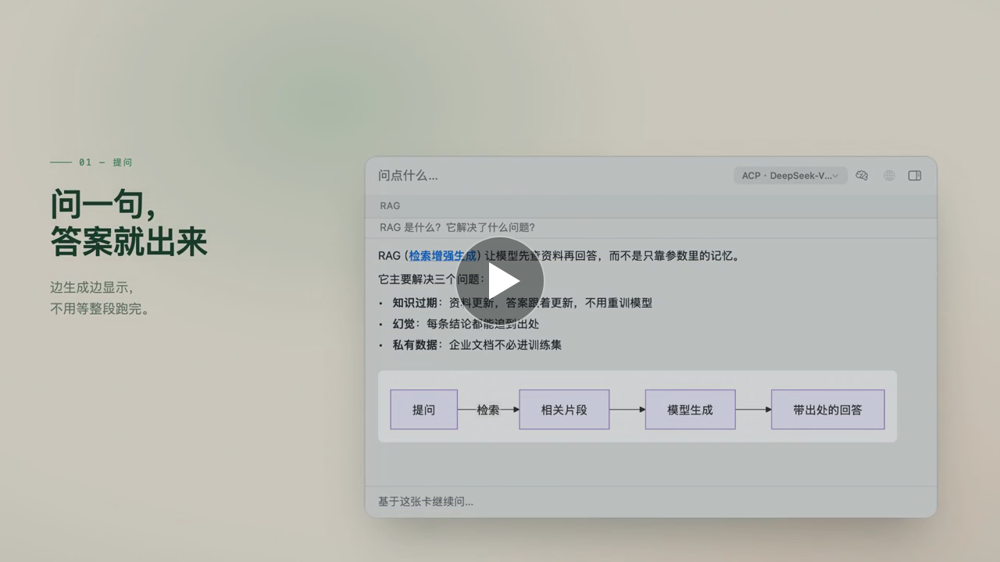
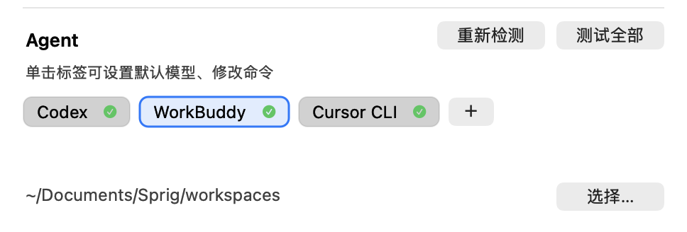

# 知枝 · Sprig

[中文](README.md) · [English](README.en.md)

[](https://github.com/thatwzzh/sprig/stargazers)
[](https://github.com/thatwzzh/sprig/releases)
[](https://github.com/thatwzzh/sprig/releases/latest)
[](LICENSE)
[](https://www.apple.com/macos/)

**按一下 `⌥Space`，问一句，答案就出来了。答案里任何文字都能选中「解释」，每次解释都在右侧知识树里长出一张子卡——知识像枝一样长，所以叫「知枝」。**

不是聊天客户端，也不是笔记软件。它只做一件事：**把「问」和「追问」之间的摩擦降到接近零**。

### 下载　[🇨🇳 国内镜像](https://sprig-site.app.workbuddy.host/downloads/Sprig-latest.zip?sharecode=HVF3SOVDGG)　·　[🌍 GitHub Releases](https://github.com/thatwzzh/sprig/releases)

> 国内直连更快；GitHub 适合海外或想下历史版本。也可以在[官网](https://sprig-site.app.workbuddy.host/?sharecode=HVF3SOVDGG)看演示。

<p align="center">
  <a href="https://sprig-site.app.workbuddy.host/?sharecode=HVF3SOVDGG" target="_blank" rel="noopener">
    
  </a>
</p>

## 这是什么

一个常驻菜单栏的**问答面板**。和网页版 AI 的区别在于**知识会积累**：

- 问第一个问题，得到一张根卡
- 看到不认识的词，选中 → `解释`，长出一张子卡
- 子卡再解释，再长——形成一棵可以回溯的知识树

每张卡都记得自己在哪个上下文里诞生，追问时只带相关的祖先节点，不会一次性塞进整段对话。

数据全在本机（`~/Library/Application Support/Sprig/repository/`），模型调用直连你配置的服务商。

## 快速开始

### 1. 安装

**要求**：macOS 14 (Sonoma) 及以上。Apple Silicon 和 Intel 都能跑。

1. 从 [Releases](https://github.com/thatwzzh/sprig/releases) 下载最新的 `.zip`
2. 解压，把 `Sprig.app` 拖到「应用程序」
3. 首次打开会提示"无法验证开发者"——去**系统设置 → 隐私与安全性**，点「仍要打开」

   > 应用没做代码签名（个人项目），这一步绕不过。介意的话可以自己编译。

4. 打开后菜单栏会出现一枝嫩芽图标，按 `⌥Space` 唤起面板

### 2. 接入一个能回答的东西

**有三条路，按你的情况选**：

| 你想… | 走哪条 | 成本 |
|---|---|---|
| 已经装了 Claude Code / Cursor / CodeBuddy 这类 CLI agent | **本机 agent**（推荐） | 0，用你已有的 |
| 想用云端模型 | 免费 / 自定义 API Key | 免费有限流 |
| 不想联网，或数据敏感 | 本地 Ollama | 0，占内存 |

设置页 → **Agent** 会自动列出本机已装的 agent，标签后面是握手状态：

| 图标 | 含义 |
|---|---|
| ✓ | 握手通过，可以直接用 |
| ! | 没登录——去终端用这个 agent 自己的方式登录一次 |
| ✕ | 失败，悬停看原因 |
| ◌ | 正在测 |
| ○ | 还没测 |

没有 agent 的话，去「模型接入」里填一个 API Key。免费通道里智谱 GLM-4.7-Flash 最稳定（但也有约 1/3 的请求会被限流）。

### 3. 问第一个问题

`⌥Space` → 输入 → 回车。答案会流式出现。

### 4. 让知识长起来

选中答案里不认识的词 → `解释`。一张子卡就长出来了，挂在原卡下面。

## 核心交互

| 动作 | 方式 |
|---|---|
| 唤起 / 收起 | `⌥Space`（可改） |
| 提问（新根卡） | 顶部输入框，回车 |
| 基于当前卡追问 | 底部输入框，回车（自动挂成子卡，带上下文） |
| 解释选中文字 | 选中 → `解释` |
| 点术语直接展开 | 答案中带下划线的术语，单击即生成子卡 |
| 返回父卡 | 点面包屑 / `⌘[` |
| 切换模型 / agent / 思考强度 | 输入框右侧的胶囊、🧠 图标 |
| 联网搜索开关 | 输入框右侧的地球仪，开着时变蓝 |
| 报错后重试 | 答案末尾的「↻ 重试本次对话」 |
| 设置 | `⌘,` 或菜单栏「设置…」 |
| 收起 | `Esc`：先收树 → 再取消输入框焦点 → 最后收起 |

**几个顺手的设计**：

- 答案里的术语会自动加下划线，点一下就能展开
- 流式输出时切到别的卡，那张卡会在**后台继续生成**，切回去能看到完整内容
- 面板高度流式期间只增不减，不会因为换行忽高忽低
- 翻看历史时不会被拽回底部——只有贴底才跟随新内容

## 跨应用选词

除了在答案里选词，知枝也能把**其他 App 里选中的文字**变成一张带来源的解释卡：

| 入口 | 用法 | 需要权限 |
|---|---|---|
| 热键 | 选中文字 → `⌥⇧Space`（可在设置里改） | 辅助功能（只读取当前选区） |
| 菜单栏 | 「解释当前选区」/「解释剪贴板内容」 | 选区需要辅助功能；剪贴板不需要 |
| 服务菜单 | 任意 App 选中文字 → 右键 → 服务 →「用知枝解释」 | 无 |
| URL scheme | `open "sprig://explain?text=…&url=…&title=…"` | 无 |

解释时会尽量带上来源上下文：**网页**抓公网正文并定位选区所在段落；**本地 Markdown / Obsidian / PDF / Office 文档** 按窗口标题或文件路径反查，带标题层级/页码和所在段落；**DSH 对话**通过专用插件取真实消息上下文；**其他 App** 尽力取 AX 周边文字。来源显示在问题条上方，点一下可回原文。

长文档不是只取选区邻居：Markdown 按标题、PPTX 按幻灯片、网页按段落切 section，先取选区所在段落，再用选区关键词（中文二元组 + 英文词）从其他 section 补 1–2 段最相关的原文；PDF 以选区为中心跨页开窗，选区在页首时会自然带上一页尾部。**默认全程本地计算，不做 LLM 摘要**，上下文上限约 1200 字；来源行右侧的 ⓘ 可以预览实际送进模型的上下文和 token 估算。

设置里可打开「深度上下文（长文档/长对话摘要）」：只有上下文明显超过预算（约 1200 token）时，才调用当前模型把周边资料压缩成摘要（选区原文保留），摘要按内容缓存、同一份内容不重复调用；模型接入未配置时自动退回本地截取，不影响解释。

边界与隐私：

- 不做后台监听；只在按热键 / 点菜单 / 走服务时读取一次选区。
- 辅助功能首次使用需要在系统设置里授权。**ad-hoc 构建每次重装后会重新询问**，这是 macOS 按签名记账的行为，不是知枝能绕过的。
- 网页抓取只请求公网 `http(s)`，拒绝内网/本机地址；设置里可关。
- 文档反查需要手动添加文档文件夹或 Obsidian 库，**不自动扫 `~/Documents`**。
- PDF 只支持有文字层的文档，扫描版 PDF 没有文本可抽，只会有选区；Office 只抽正文文字（docx 段落 / pptx 幻灯片 / xlsx 行），不还原图片、图表和版式。
- DSH 对话请用专用插件取选区 + 上下文；其他 Electron 对话 AX 读不到时会模拟一次 ⌘C 并还原剪贴板，只保证选区，拿不到会话前后文。
- ACP Agent 模式是**问答模式**：不会让 agent 调用 Grep/Bash/Read 等工具，工具权限会自动拒绝；需要 agent 真正执行任务请直接在 agent 客户端里做。

### 跨应用选词设置

菜单栏 →「设置…」（知枝设置）→ 顶部 **「常规 / 跨应用选词」** 两个标签页：

- **常规**：模型接入、Agent、知识库、联网搜索、深度上下文等；
- **跨应用选词**：总开关、解释选区快捷键、辅助功能状态/去授权、选区长度上限（默认 500 字，可配 200–2000）、网页上下文开关、文档反查（可选）。

**文档文件夹 / Obsidian 库不是必须配置的**：不配置也能正常解释选区。它们只用于「目标 App 不提供文件路径、需要按窗口标题反查本地文档」的场景（例如某些编辑器）。网页抓取、DSH 插件、URL scheme 显式 `path`、AXDocument 文件路径都不依赖这两个配置。

不再有单独的「跨应用划词设置…」菜单入口。深度上下文开关在「常规」标签页的「联网搜索」区域。

### URL scheme / 快捷指令

`sprig://explain` 适合 Raycast / Alfred / 快捷指令 / 书签小工具接力：

| 参数 | 说明 |
|---|---|
| `text` | 必填，选中文字（URL 入口上限 500 字） |
| `title` / `url` / `path` / `app` | 来源线索 |
| `kind` | `web/agent/markdown/note/app/clipboard/pdf/document`，缺省按 url/path 推断 |
| `context` / `question` | 可选：入口方已取到的上下文 / 顺带的问题 |

```bash
open "sprig://explain?text=%E5%B9%BB%E8%A7%89&title=RAG&url=https%3A%2F%2Fexample.com%2Frag&kind=web"
```

URL scheme 只适合短内容（`text` 上限 500 字、`context` 上限 1000 字）；DSH 插件走的是本地 bridge，不经过 URL scheme。

## 知识树

每张卡片都记得自己在哪个上下文里诞生，追问时只带相关的祖先节点。

| 动作 | 方式 |
|---|---|
| 开关知识树 | `⌘⇧T`（设置里可重新录制） |
| 搜索 | `⌘F`，匹配标题和回答正文 |
| 重命名 | 单击已选中的节点，或回车；失焦提交，`Esc` 取消 |
| 删除 | hover 节点点垃圾桶，或 `⌘⌫`；模态弹窗确认 |

- 删除是级联的：删一张卡会带着它的所有子卡一起走
- 搜索命中会在节点上标出来，点一下跳到那张卡

## 答案渲染

回答按 Markdown 排版，不会把符号原样糊在屏幕上：

- 标题、列表、引用、表格都按排版画，表格会自动折行
- 代码块按语言着色（Swift / Python / JS / Go / SQL / nginx 等），行内代码带底色
- `mermaid` 流程图、时序图直接画成图；画不出来就显示源码
- `$$...$$` / `\[...\]` 数学公式用本地 KaTeX 画成图（行内 `$...$` / `\(...\)` 也支持），不联网；渲染失败退回源码
- `sprig-chart` 用 JSON 画柱状图 / 折线图

## 阅读主题

答案区有 10 套主题，默认 GitHub。另有 Newsprint（衬线正文）、Solarized、One、Catppuccin、Dracula、Nord、Gruvbox、Rosé Pine、Tokyo Night。

每套都带明暗两组色值，跟随系统外观自动切换；只换排版和配色，不动内容，切换后已有卡片跟着重排。

设置页 → 阅读主题。

## DSH 对话内选词插件

仓库里的 `dsh-plugins/sprig/` 是 DSH（DeepSeek Harness）Client 插件：

- 选中 DSH 对话文字后，DSH 原有的「引用」操作条会变成 **复制 / 引用 / 用知枝解释**，不再额外弹一个和原生 Copy 重叠的右键表面；
- 只读取选中消息前后各最多一条**真实用户/助手消息**，过滤 `<system-reminder>`、`available_skills`、context 节点，总长 ≤1800 字；
- 通过本机 `127.0.0.1:53917` 的 bridge 发给**正在运行的知枝**，由知枝建卡并解释；
- 需要知枝已启动，且设置里启用了「启用跨应用划词」；
- 只对 DSH Web UI 生效；终端/CLI 不生效。

安装：DSH 设置 → **Plugins → Add plugin**，选择 `dsh-plugins/sprig` 目录；或让 agent 用 `install_bundle` 安装。安装/更新后刷新 DSH 页面或新开会话。

> 插件复用了 DSH 原生 `quote` 表面（key 相同、priority 更低覆盖）；DSH 升级后如果内部表面实现变化，需要跟着适配。bridge 只监听回环地址、无 token，仅能创建解释卡，不读取本机数据；请求日志写到 `/tmp/sprig-bridge.log`。

## 接入本机 agent

**如果你已经装了 Claude Code、Cursor、CodeBuddy、Gemini CLI 这类命令行 agent，这是最省事的路子**：知枝把问题和上下文交给它们，由它们回答。

> ⚠️ 知枝里的 Agent 是**问答模式**，不是编码工作台：会在 prompt 末尾要求 agent 不要调用任何工具、不要读写文件/工作区；即使 agent 仍请求工具权限，知枝也会自动拒绝并隐藏工具过程。需要执行命令或改文件，请直接在对应 agent 客户端里操作。

**设置页 → Agent** 会自动列出本机已装的：

<p align="center">
  
</p>

- **测试全部**：逐条握手
- **重新检测**：装、卸 agent 之后点它，不用重开设置
- **＋**：添加自定义 agent（名称 + 启动命令）
- **单击标签**：配**默认模型**，自定义的还能改名字和命令。模型要先点「读取」拉一次清单，首项是「跟随 agent 默认」
- **工作目录**：所有 agent 共用，是 agent 读写文件的当前目录

**怎么切**：对话窗口底部的模型胶囊 →「Agent」组。选中期间联网开关会置灰——联不联网由 agent 自己决定。

**等待期**会显示“正在思考…”和模型的思考片段；不会显示工具过程，也不会弹工具权限。

**没登录时**：面板会显示登录链接，点开在浏览器里完成，agent 随后自动重试。

**权限**：知枝不执行 agent 的工具，工具权限会被自动拒绝；这样连续追问不会卡在一串“需要许可”上。

## 接入云端模型

| 类别 | 说明 |
|---|---|
| **本地 Ollama** | 跑在本机，完全免费 |
| **免费** | 智谱 GLM，填个 Key 就能用 |
| **自定义** | 任何 OpenAI 兼容服务（DeepSeek、OpenAI、火山方舟…） |

### 本地（Ollama）

只填地址和模型名。地址默认 `http://127.0.0.1:11434`，点「同步模型」会自动列出本机已 pull 的模型。

> **注意**：pull 很多模型不会同时吃内存。模型只在被调用时加载，闲置 10 分钟后自动卸载。真正占磁盘的是权重文件（一个 9B 模型约 10 GB）。

### 免费

| 通道 | 领 Key 的地方 | 模型 |
|---|---|---|
| 智谱 GLM | [bigmodel.cn/usercenter/proj-mgmt/apikeys](https://bigmodel.cn/usercenter/proj-mgmt/apikeys) | `glm-4.7-flash` |

**智谱要实名认证**——没实名的账号生成的 Key 用不了。

**⚠️ 关于免费模型的稳定性**：

| 通道 | 实际体验 |
|---|---|
| 智谱 GLM-4.7-Flash | 实测成功率约 1/3，多数返回「访问量过大」 |

**它适合试一下这个 app 是不是你想要的**，不适合当日常主力。要稳定就用 DeepSeek（自定义接入，按 token 计费，充 10 元用几个月）或本地 Ollama。

### 自定义

填名称、Base URL、Key、模型名，可以加任意多条：

| 平台 | Base URL | 模型示例 |
|---|---|---|
| **DeepSeek** | `https://api.deepseek.com` | `deepseek-chat`（快）/ `deepseek-reasoner`（推理）|
| OpenAI | `https://api.openai.com/v1` | `gpt-4o-mini` |
| 火山方舟（豆包） | `https://ark.cn-beijing.volces.com/api/v3` | 控制台的接入点 ID |
| 阿里百炼 | `https://dashscope.aliyuncs.com/compatible-mode/v1` | `qwen-flash` |
| Groq | `https://api.groq.com/openai/v1` | `openai/gpt-oss-120b` |
| LM Studio | `http://127.0.0.1:1234/v1` | 加载的模型名 |

Base URL 填到 `/v1` 或只填域名都能识别，`https://x/v1` 不会被拼成 `/v1/v1`。

### 代理

**设置页「联网搜索」下面有一行「代理」**，填 `http://127.0.0.1:7890` 之类，所有出站请求都走它。留空则跟随系统设置。

什么时候需要：用境外服务（OpenAI、Tavily 搜索等）时。国内服务（DeepSeek、智谱、Ollama）不需要。

## 联网搜索

知识问答常需要最新信息，所以接了工具调用——**模型自己决定要不要搜、搜什么**，不是每次提问都塞一堆结果进去。

> Agent 接入时这个开关是禁用的——联不联网由 agent 自己决定。

配置：设置页 →「联网搜索」→ 打开开关 → 选后端 → 填 Key。

| 后端 | 额度 | 特点 |
|---|---|---|
| **Tavily** | 1000 次/月免费 | 国际搜索，质量好，需要代理 |
| **DeepSeek** | 5 元/1000 次成功请求 | 国内直连，中文结果更强 |

搜索结果折叠成一行，点开才展开：

```
🔍 搜索「今日金价」，参考了 3 条来源      ← 点这行弹出来源菜单
```

点开能看到「标题 · 域名」，悬停显示摘要，点击打开原文。

**什么时候会搜**：只有涉及时事、当前价格、最新版本号时才搜。问"什么是设计模式"这类稳定知识，模型直接凭知识回答——搜了反而拿到一堆营销文。

## Markdown 同步

**一棵知识树 = 一个 Markdown 文件**，子卡按层级写在同一个文件里：

```markdown
<!-- sprig:root 7D51CB74-... -->

# RAG

RAG 是什么？

RAG（检索增强生成）是结合检索与生成的 AI 方法。

## 幻觉

> 选中：幻觉

这里指模型编造看似合理但错误的事实。

本文由知枝生成。要修改内容，请在应用里改；直接改这个文件不会写回知识库。
```

- 文件写在知识库目录里（默认 `~/Library/Application Support/Sprig/repository/`），和 `.cards.json` 同一个文件夹
- **Markdown 是投影，不是源**：在应用里改会重新生成；直接改文件，下次保存会被覆盖
- 首行的 `<!-- sprig:root ... -->` 是标记。删主卡时只删带标记的文件，你自己放进去的笔记不会被碰
- 换知识库目录时，如果目标目录还没有库，会先把当前库复制过去

## 配置与备份

| 项 | 位置 | 默认值 |
|---|---|---|
| 模型接入 | 菜单栏「设置…」→ 模型接入 | 智谱免费 + Ollama |
| Agent | 菜单栏「设置…」→ Agent | 自动列出本机已装的 |
| Agent 工作目录 | 设置页 → Agent → 工作目录 | `~/Library/Application Support/Sprig/workspaces` |
| 知识库位置 | 菜单栏「设置…」→ 知识库 → 选择… | `~/Library/Application Support/Sprig/repository` |
| 阅读主题 | 菜单栏「设置…」→ 阅读主题 | GitHub |
| 代理 | 菜单栏「设置…」→ 联网搜索 → 代理 | 空（跟随系统） |

**API Key 存在本机偏好设置里**（`~/Library/Preferences/com.catking.sprig.app.plist`），**明文**，别把这份配置同步到云端。

```bash
defaults export com.catking.sprig.app ~/sprig-backup.plist
defaults import com.catking.sprig.app ~/sprig-backup.plist
```

## 常见问题

### 提示「无法验证开发者」

关掉弹窗，再去系统设置 → 隐私与安全性 → 拉到底，点「仍要打开」，输密码或触控 ID。

### 菜单栏图标不见了

macOS 26（Tahoe）的 Control Center 会按 App 记录菜单栏可见性；重新打包后可能出现「`isVisible=true` 但窗口被放到屏幕外 y=-22」的情况（这是系统行为，没有公开 API 可以强制恢复）。新版启动时会：

1. 检查状态项窗口是否被放到了屏幕外，自动重试重建/切换可见性（静默处理，不弹窗）；
2. 如果仍被隐藏，请手动修复：**系统设置 → 菜单栏 → 找到「知枝」→ 选择「在菜单栏中显示」**（或把它从隐藏区拖回菜单栏）。之后系统会记住；也可以直接用 `⌥Space` / `⌥⇧Space` 使用面板。

### 跨应用划词没反应 / 读不到选区

1. 检查 **系统设置 → 隐私与安全性 → 辅助功能** 里知枝是否勾选；ad-hoc 构建每次重建后都要重新勾一次（授权弹窗出现时知枝面板会自动降到普通层级，不会挡住弹窗）。
2. 面板已经在前台时按热键不会读知枝自己；先切到目标 App 并选中文字。
3. Chrome / Electron 第一次取词可能为空（无障碍树要预热），再按一次。
4. 当前 App 不暴露 AX 选区时，先复制文字，用菜单栏「解释剪贴板内容」兜底。
5. 想看诊断信息：`Sprig --capture-selection` 会打印是否授权、读到的选区/来源。

### 一直 429

免费额度用完了。等一分钟，或者换成付费接入。

### TLS 握手失败

多半是网络到不了目标域名：用 OpenAI / Tavily 这类境外服务时先配好代理，或者把搜索后端换成 DeepSeek。

### 知识库想放 Documents 里

可以放，但**首次会要授权，换 app 版本后会再问一次**（系统按应用身份记账）。设置页会把这类路径标成橙色「（受系统保护）」。

想要授权一次之后重构建也不重问，用一个稳定的签名身份（`SPRIG_SIGN_IDENTITY`）。详见 ARCHITECTURE。

## 开发者

技术细节都在 [ARCHITECTURE.md](ARCHITECTURE.md)：分层、数据流、上下文装配、ACP 接入、渲染管线、无界面验证。

### 从源码构建

```bash
git clone https://github.com/thatwzzh/sprig.git
cd sprig
./scripts/make-app.sh          # 打包成 build/Sprig.app
open build/Sprig.app

swift test --disable-sandbox   # 单测
./scripts/restart-app.sh       # 退出旧实例 → 打包 → 启动 → 校验只有一个实例
```

### 发版

版本号只有一个来源：**git tag**。打包脚本从这里读。

```bash
git tag v0.2.1 && git push origin v0.2.1
./scripts/release.sh            # 检查 → 构建 → 校验 → build/Sprig-v0.2.1.zip
gh release create v0.2.1 build/Sprig-v0.2.1.zip --title "知枝 v0.2.1"
```

脚本会拦下四种「版本会错」的情况：工作区有未提交改动、不在 main、HEAD 不在 tag 上、包内版本/tag 对不上。

### 常用调试

```bash
Sprig --selftest                  # 无界面校验布局/选区/复制
Sprig --settings --dump           # 打印设置表单状态
Sprig --headless "问题"            # 只跑 provider + 解析器
Sprig --test-agents               # 逐条测试已配置的 agent
Sprig --acp-host-info             # 查看内置 acp-host 路径与版本
Sprig --acp-host-probe "问题"     # 不经过 UI，验证 acp-host 链路
Sprig --direct-acp-probe "问题"   # 不经过 UI，验证直连 ACP 链路
Sprig --readme-shots /tmp/shots   # 用临时知识库生成 README 配图
SPRIG_ACP_TRACE=/tmp/acp.log Sprig --ask "你好"   # 记录 ACP 原始帧

# 跨应用选词（P0/P1）
Sprig --capture-selection [pid]   # AX 取词诊断（需辅助功能权限）
Sprig --request-accessibility     # 触发系统授权提示并打印状态
Sprig --prompt-explain /tmp/e.json          # 打印外部选词的 system/user 消息
Sprig --resolve-context /tmp/e.json [--no-fetch]  # 来源上下文解析 + 最终 Prompt
Sprig --explain-url "sprig://explain?..." --dry-run  # 只解析入口，不流式
Sprig --math-demo '\frac{a}{b}' /tmp/math.png       # 校验 KaTeX 公式渲染
Sprig --math-panel-demo /tmp/math-panel.png         # 造一张公式卡拍面板

# DSH 插件 / 本机 bridge
tail -f /tmp/sprig-bridge.log      # DSH 插件 POST 是否到达知枝
tail -f /tmp/sprig-trace.log       # ACP 流式各阶段（排查一直生成中）
```

完整列表见 ARCHITECTURE 的「测试与调试」章节。

---

**License**: MIT · **反馈**: [Issues](https://github.com/thatwzzh/sprig/issues)
